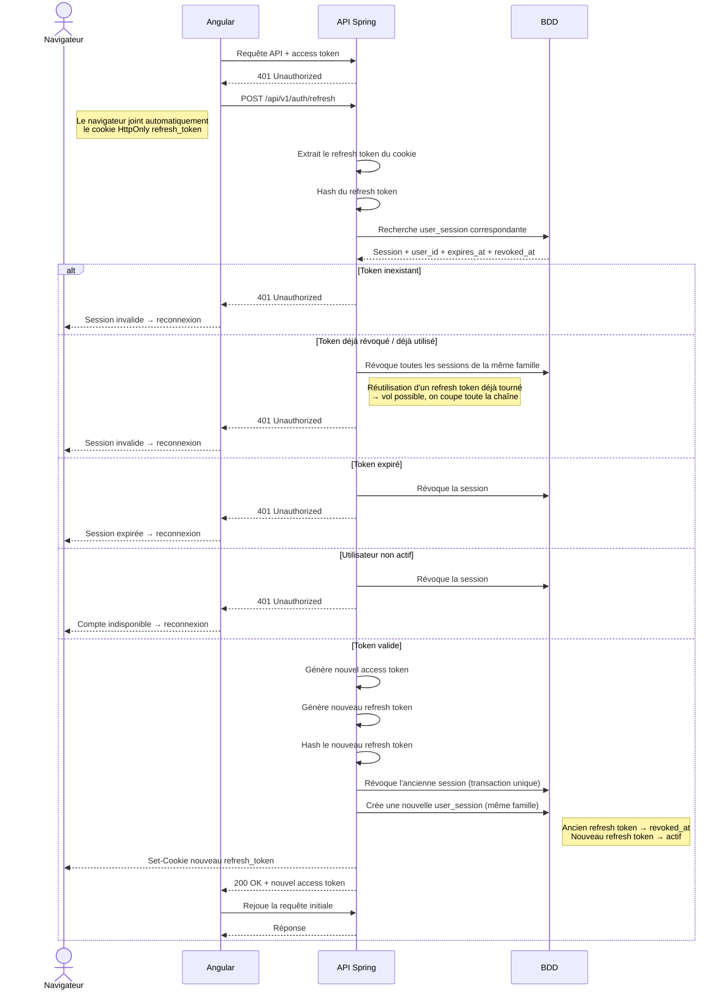

# Séquence : refresh



Tous les `401` ont le même corps (« Session expirée, veuillez vous reconnecter ») : le client ne distingue pas un token inconnu, révoqué, expiré ou un compte désactivé.

## État de la mise en œuvre

- **Fait (C1) :** le token est lu dans le cookie uniquement (cookie absent = même `401`, token dans le corps ignoré) ; rotation avec révocation de l'ancien token et nouveau `Set-Cookie` ; refus uniformes.
- **Pas encore fait (C3) :** hachage, `user_sessions`, familles et révocation de toute la famille en cas de réutilisation. Aujourd'hui, un token réutilisé est simplement refusé, et un token expiré ou d'un compte désactivé n'est pas révoqué en base.
- **Pas encore fait (phase D) :** un seul refresh partagé quand plusieurs requêtes reçoivent `401` en même temps.

# Séquence : logout

```mermaid
sequenceDiagram
actor Navigateur
participant Angular
participant API as API Spring
participant BDD

    Navigateur->>Angular: Clic « Déconnexion »
    Angular->>API: POST /api/v1/auth/logout + access token
    Note right of Navigateur: Le cookie refresh_token n'est pas envoyé<br/>(Path = /api/v1/auth/refresh)

    alt Access token valide
        API->>BDD: Révoque tous les refresh tokens de l'utilisateur
        API-->>Navigateur: 204 + Set-Cookie refresh_token= ; Max-Age=0
        Note right of Navigateur: Mêmes attributs et même Path :<br/>le navigateur supprime le cookie
    else Access token expiré ou absent
        API-->>Angular: 401 ou 403, rien n'est révoqué
        Note right of API: Limite connue, à traiter en C4<br/>(révocation à partir du cookie)
    end

    Angular->>Angular: Efface la session locale (finalize, succès ou échec)
    Angular-->>Navigateur: Redirection vers /login
```
