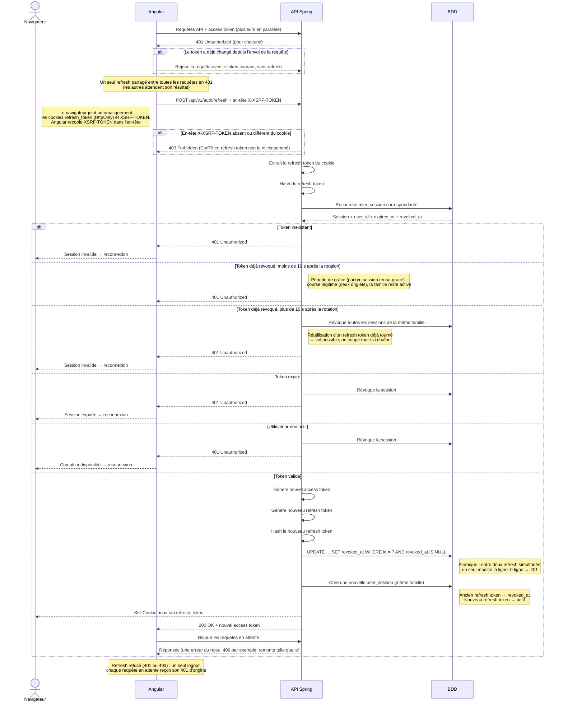
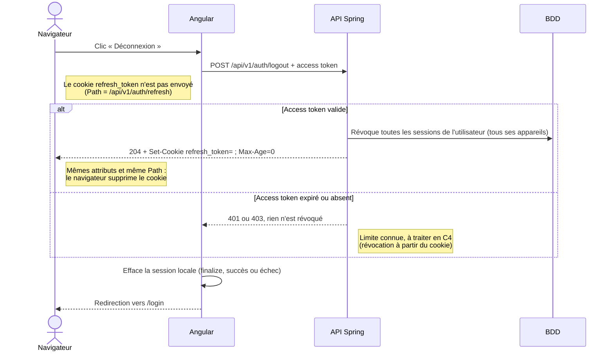

# Séquence : refresh

Tous les `401` ont le même corps (« Session expirée, veuillez vous reconnecter ») : le client ne distingue pas un token inconnu, révoqué, expiré ou un compte désactivé.

## État de la mise en œuvre

- **Fait (C1) :** le token est lu dans le cookie uniquement (cookie absent = même `401`, token dans le corps ignoré) ; rotation avec révocation de l'ancien token et nouveau `Set-Cookie` ; refus uniformes.
- **Fait (C2) :** protection CSRF par double-submit (`403` sans en-tête ou avec une valeur fausse) ; révocation atomique de l'ancien token (`revokeIfActive`), un seul refresh réussit parmi des requêtes simultanées ; côté Angular, refresh partagé, rejeu sans refresh si le token a déjà changé, un seul logout en cas d'échec.
- **Fait (C3) :** `user_sessions` (empreinte SHA-256 seulement, token de 256 bits), rotation dans la même famille, session expirée ou compte non actif révoqué en base avant le `401` (`noRollbackFor = SessionRejectedException.class`), révocation de toute la famille en cas de réutilisation au-delà de la période de grâce (10 s). `refresh_tokens` n'est plus utilisée.
- **Limite connue (grâce) :** si un voleur fait la rotation avant l'utilisateur et que celui-ci représente l'ancien token dans les 10 s, la famille n'est pas révoquée et le voleur garde son nouveau token. Grâce à retirer quand Angular aura un verrou entre onglets (phase D).

# Séquence : logout

