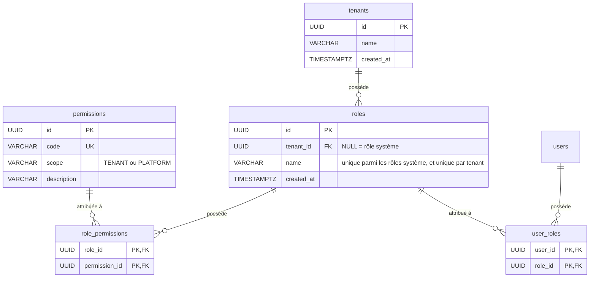
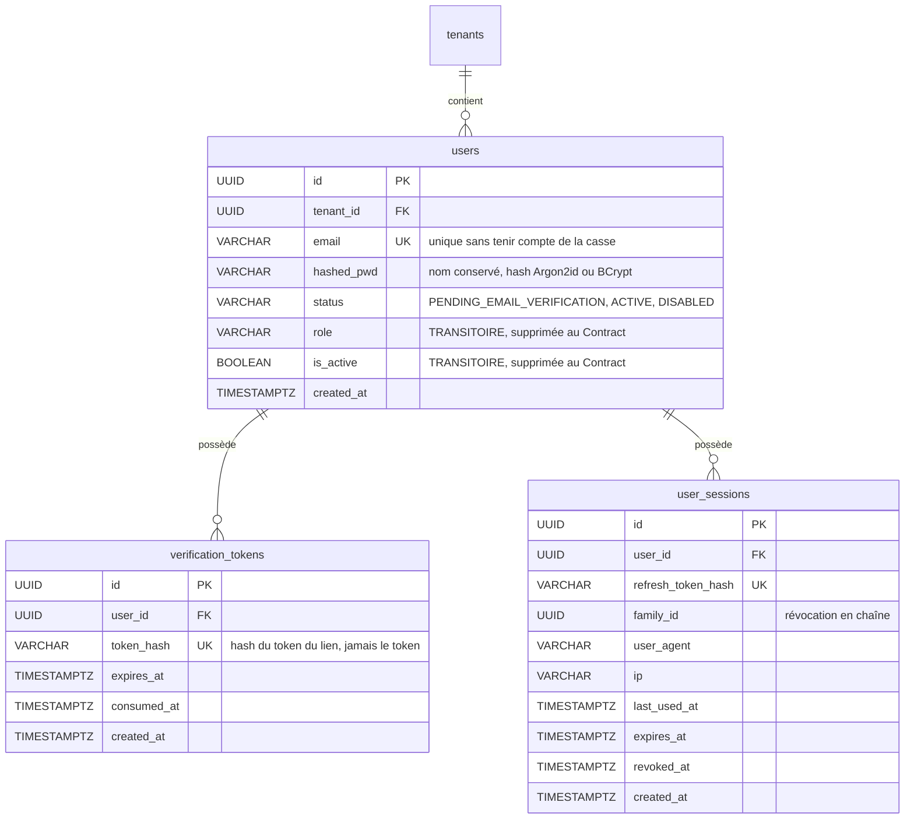
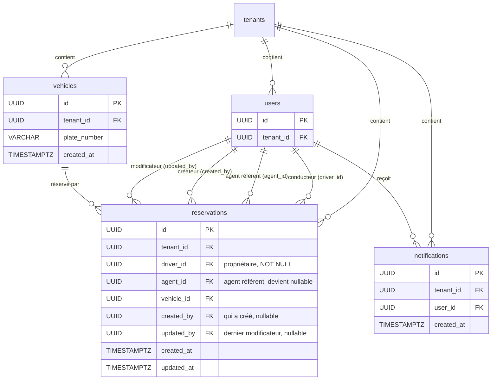

# Schéma lot 1a

Les diagrammes montrent les clés et les colonnes ajoutées ou modifiées au lot 1a. Les colonnes existantes sans changement (noms, marque, kilométrage, etc.) ne sont pas répétées.

# Rôles et permissions

Contraintes de `roles.name` (deux index uniques partiels) :

- `UNIQUE (name) WHERE tenant_id IS NULL` pour les rôles système.
- `UNIQUE (tenant_id, name) WHERE tenant_id IS NOT NULL` pour les rôles d'un tenant.

# Utilisateurs et authentification

Contraintes et index :

- **Email :** `UNIQUE (lower(email))`. La colonne reste nullable uniquement pour les comptes existants sans email, qui sont désactivés à la migration : `CHECK (email IS NOT NULL OR status = 'DISABLED')`.
- **Statut :** `CHECK (status IN ('PENDING_EMAIL_VERIFICATION', 'ACTIVE', 'DISABLED'))`.
- **Conversion :** `is_active = TRUE` donne `ACTIVE`, `is_active = FALSE` donne `DISABLED`, et tout utilisateur sans email devient `DISABLED`.
- **Sessions :** index sur `(user_id, revoked_at)` et sur `family_id`.
- **Rôles :** index inverse `(role_id, user_id)` sur `user_roles`, pour lister les utilisateurs d'un rôle.
- **Anciennes sessions :** les lignes de `refresh_tokens` ne sont pas migrées. Les utilisateurs se reconnectent au déploiement, et la table est supprimée au Contract.

# Ressources métier

Règles de suppression des clés étrangères :

| Clé | Règle | Raison |
|---|---|---|
| `reservations.driver_id` | `RESTRICT` | Propriétaire de la réservation, et base de la portée `own`. On désactive et on anonymise un compte, on ne le supprime pas. |
| `reservations.agent_id`, `created_by`, `updated_by` | `SET NULL` | Colonnes nullables : l'historique reste, la référence disparaît. |
| `user_roles.user_id` | `CASCADE` | Sans utilisateur, l'association n'a plus de sens. |
| `verification_tokens.user_id`, `user_sessions.user_id` | `CASCADE` | Même raison. |

Backfill des réservations existantes : `created_by` reçoit la valeur de `agent_id`.
